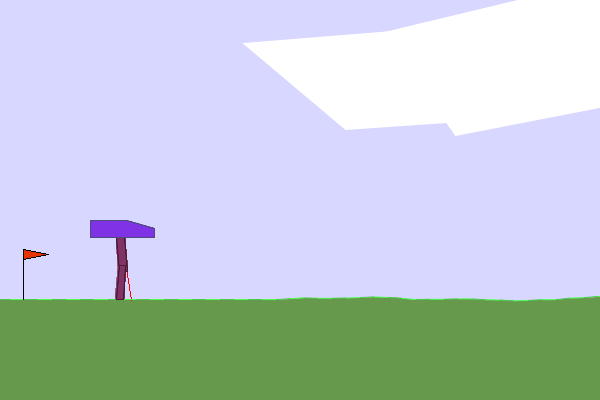
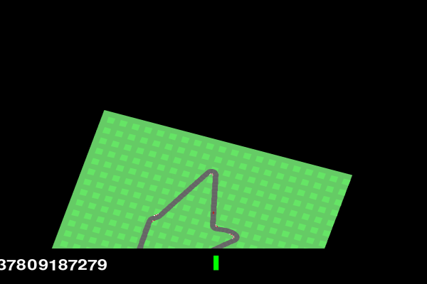
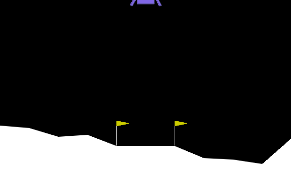

# Box2D


<div class="env-grid">
    
            <a href="bipedal_walker">
                <div class="env-grid_\_cell">
                    <div class="cell_\_image-container">
                        
                    </div>
                    <div class="cell_\_title">
                        <span>Bipedal Walker</span>
                    </div>
                </div>
            </a>
    

            <a href="car_racing">
                <div class="env-grid_\_cell">
                    <div class="cell_\_image-container">
                        
                    </div>
                    <div class="cell_\_title">
                        <span>Car Racing</span>
                    </div>
                </div>
            </a>
    

            <a href="lunar_lander">
                <div class="env-grid_\_cell">
                    <div class="cell_\_image-container">
                        
                    </div>
                    <div class="cell_\_title">
                        <span>Lunar Lander</span>
                    </div>
                </div>
            </a>
    
</div>

    #### WARNING
If you plan to use box2d with Python 3.14 or later, know that at the moment the upstream project [pybox2d](https://github.com/pybox2d/pybox2d) only provides pre-built wheels for Python 3.13 or earlier. As a workaround, the `box2d` extra builds [box2d-py](https://pypi.org/project/box2d-py/) from source and additionally requires `swig`. Make sure you have [SWIG](https://swig.org/) installed on your system.

These environments all involve toy games based around physics control, using [box2d](https://box2d.org/) based physics and PyGame-based rendering. These environments were contributed back in the early days of OpenAI Gym by Oleg Klimov, and have become popular toy benchmarks ever since. All environments are highly configurable via arguments specified in each environment’s documentation.

The unique dependencies for this set of environments can be installed via:

```bash
pip install swig  # only needed for Python 3.14+
pip install "gymnasium[box2d]"
```

[SWIG](https://swig.org/) is necessary for building the wheel for [box2d-py](https://pypi.org/project/box2d-py/), the Python package that provides bindings to box2d on Python 3.14+. For Python 3.13 or below we use the pre-built wheel from [pybox2d](https://github.com/pybox2d/pybox2d).
