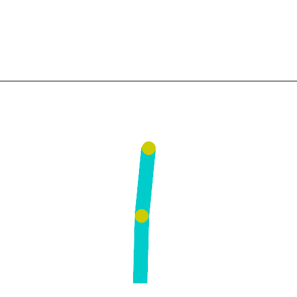
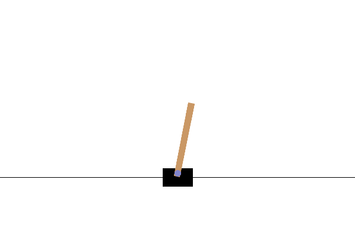
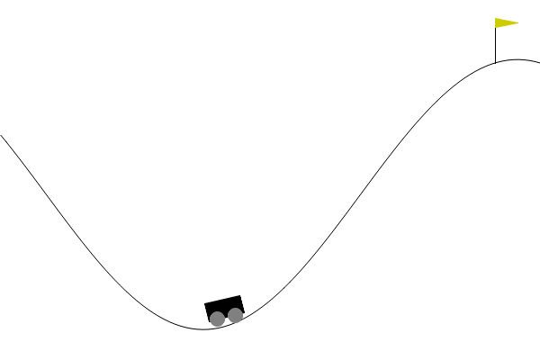
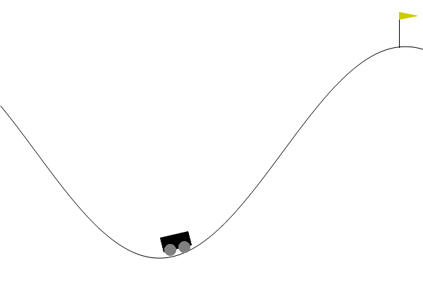

# Classic Control


<div class="env-grid">
    
            <a href="acrobot">
                <div class="env-grid_\_cell">
                    <div class="cell_\_image-container">
                        
                    </div>
                    <div class="cell_\_title">
                        <span>Acrobot</span>
                    </div>
                </div>
            </a>
    

            <a href="cart_pole">
                <div class="env-grid_\_cell">
                    <div class="cell_\_image-container">
                        
                    </div>
                    <div class="cell_\_title">
                        <span>Cart Pole</span>
                    </div>
                </div>
            </a>
    

            <a href="mountain_car_continuous">
                <div class="env-grid_\_cell">
                    <div class="cell_\_image-container">
                        
                    </div>
                    <div class="cell_\_title">
                        <span>Mountain Car Continuous</span>
                    </div>
                </div>
            </a>
    

            <a href="mountain_car">
                <div class="env-grid_\_cell">
                    <div class="cell_\_image-container">
                        
                    </div>
                    <div class="cell_\_title">
                        <span>Mountain Car</span>
                    </div>
                </div>
            </a>
    

            <a href="pendulum">
                <div class="env-grid_\_cell">
                    <div class="cell_\_image-container">
                        
                    </div>
                    <div class="cell_\_title">
                        <span>Pendulum</span>
                    </div>
                </div>
            </a>
    
</div>

    The unique dependencies for this set of environments can be installed via:

```bash
pip install "gymnasium[classic-control]"
```

There are five classic control environments: Acrobot, CartPole, Mountain Car, Continuous Mountain Car, and Pendulum. All of these environments are stochastic in terms of their initial state, within a given range. Also, regarding both mountain car environments, the cars are underpowered to climb the mountain, so it takes some effort to reach the top.

Among Gymnasium environments, this set of environments can be considered easier ones to solve by a policy.

All environments are highly configurable via arguments specified in each environment’s documentation.
