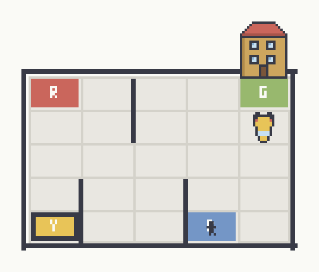

# Toy Text


<div class="env-grid">
    
            <a href="blackjack">
                <div class="env-grid_\_cell">
                    <div class="cell_\_image-container">
                        
                    </div>
                    <div class="cell_\_title">
                        <span>Blackjack</span>
                    </div>
                </div>
            </a>
    

            <a href="cliff_walking">
                <div class="env-grid_\_cell">
                    <div class="cell_\_image-container">
                        
                    </div>
                    <div class="cell_\_title">
                        <span>Cliff Walking</span>
                    </div>
                </div>
            </a>
    

            <a href="frozen_lake">
                <div class="env-grid_\_cell">
                    <div class="cell_\_image-container">
                        
                    </div>
                    <div class="cell_\_title">
                        <span>Frozen Lake</span>
                    </div>
                </div>
            </a>
    

            <a href="taxi">
                <div class="env-grid_\_cell">
                    <div class="cell_\_image-container">
                        
                    </div>
                    <div class="cell_\_title">
                        <span>Taxi</span>
                    </div>
                </div>
            </a>
    
</div>

    The unique dependencies for this set of environments (used for rendering) can be installed via:

```bash
pip install "gymnasium[toy-text]"
```

Toy text environments are designed to be extremely simple, with small discrete state and action spaces, and hence easy to learn. As a result, they are suitable for debugging implementations of reinforcement learning algorithms.

Environments are configurable via arguments specified in each environment’s documentation.
